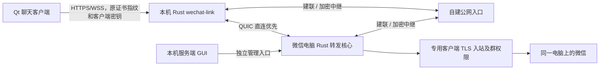

# 自动连接与自建公网入口

客户端和登录微信的服务端保持独立。Qt 界面使用原 HTTPS/WSS 协议；客户端 Rust `wechat-link` 与服务端 Rust 核心之间建立身份固定的 QUIC 通道。连接使用 iroh 1.3.0，公网入口为相同版本的自建 iroh-relay。

公网入口协助两端相互发现、探测地址并尝试打洞，直连可用时数据走双方之间的 UDP；否则加密数据继续通过入口中继。它不连接微信，也不保存聊天记录、文件、管理员密钥或微信电脑的 TLS 私钥。中继可观察连接端点和流量规模，实际中继会消耗公网服务器带宽。

客户端继续验证原微信服务端证书指纹；QUIC 还固定验证服务器设备公钥。云入口的 TLS 证书单独验证，当前部署使用私有 CA 和公网 IP 的 SAN。入口 JSON 只包含公共 CA 和专用入口接入凭据，不包含 CA 私钥、SSH 私钥或服务器设备私钥。默认公共发现服务和公共 relay 未启用。

启用与配对：

1. 按 [公网入口部署](../deploy/p2p/README.md) 安装入口，放行所选 TCP 与 UDP 端口。当前部署使用 54443。TCP 用于建联和中继，UDP 用于地址探测。仅主机内返回健康状态不能证明公网已放行。
2. 在微信电脑的服务端 GUI 停止服务，打开“连接与存储 → 自动连接”，粘贴完整入口 JSON 并启用，配置内层 TLS 后保存、启动。
3. 服务状态显示固定服务器设备 ID。本机管理接口的 `listening` 仅表示本地 P2P 入站已准备，不等于已与某个远程客户端直连。
4. 新建客户端时选择“自动连接（直连优先）”，将一次显示的客户端连接 JSON 交给对应客户端，在客户端粘贴后保存。已有业务密钥可以继续使用，无须清空群和权限。

邀请使用版本 1、`mode: "p2p"`、稳定 `p2p://<server_id>`，并携带原业务 token、原证书指纹及专用 `p2p` 入口设置。临时 `https://127.0.0.1:<port>` 只存在于运行态，不写进服务器逻辑身份或分享信息。客户端退出只关闭自己的 helper；微信服务端和云入口独立运行。

服务端将 P2P 流量送入独立的客户端 TLS listener。这个 router 不挂载 `/api/local/*` 或 `/api/shutdown`，即使代理回连地址是 loopback，也拒绝管理员密钥；客户端不能指定任意本机 TCP 转发目标。原来的全局转发群与客户端授权群交集、发送/下载权限、WebSocket 撤权及逐事件检查继续执行。

消息、文件和实时事件复用原协议，一条 QUIC 双向流对应一条 TLS 连接。双向复制各使用 64 KiB 缓冲，流和连接有并发上限。文件仍逐块读写、校验 SHA-256，不整件装入 helper 内存。P2P 模块不加入屏幕采集、直播编解码或新的语音播放器。

短暂断线后，已有 WebSocket 游标继续补漏；新 TCP 流可以重新建连，已经写入的 POST 不由隧道自动重放。上传/下载中断会失败并清理未完成文件，当前不新增断点续传协议。关闭/撤销客户端仍由原业务权限执行；若要同时撤销入口本身的带宽准入，还需轮换共享入口凭据并更新保留客户端。

验证分为本地 QUIC、完整应用协议、中继强制回退和真实跨网。`network/tests/p2p_e2e.rs` 启动临时的本地入口、真实客户端 helper 和独立的 `--demo` 服务，使用临时数据与证书，不连接真实微信。两端在同一电脑能测试完整协议和强制中继，并不证明两台不同外网设备的打洞成功率；真实跨网仍需分别验证。
