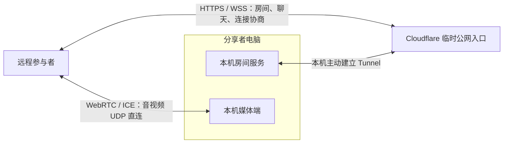

# Piik 连接机制核对

核对日期：2026-10-15。仓库为 [TNTcraftHIM/Piik](https://github.com/TNTcraftHIM/Piik)，本次固定读取提交 [`42588f3a8b1dd97eefe8700e54cbbbb09df0b2a2`](https://github.com/TNTcraftHIM/Piik/tree/42588f3a8b1dd97eefe8700e54cbbbb09df0b2a2)。本次只读源码和官方文档，没有启动 Piik、建立公网隧道或修改现有微信服务。克隆放在工作区 `.research/Piik`，不进入客户端或服务端运行包。

Piik 的“公网邀请”让用户不必填写公网 IP、手工映射路由器端口，依靠的是两条通路：公网房间服务负责进入房间和交换连接信息；WebRTC 负责尝试设备之间的音视频直连。公网辅助服务仍然存在。

| 核对项 | 实际实现与依据 |
| --- | --- |
| 公网入口 | App 的 `--link` 模式启动 `cloudflared`，upstream 是 `http://127.0.0.1:<房间端口>`。[app.go:509](https://github.com/TNTcraftHIM/Piik/blob/42588f3a8b1dd97eefe8700e54cbbbb09df0b2a2/internal/app/app.go#L509-L535) |
| Tunnel 子进程 | 参数包含 `tunnel --protocol auto --max-edge-addr-retries 0 --url <本机地址>`。解析随机 `https://*.trycloudflare.com`，还要观察到连接已注册才算启动成功。[process.go:130](https://github.com/TNTcraftHIM/Piik/blob/42588f3a8b1dd97eefe8700e54cbbbb09df0b2a2/internal/app/publictunnel/process.go#L130-L143)、[process.go:238](https://github.com/TNTcraftHIM/Piik/blob/42588f3a8b1dd97eefe8700e54cbbbb09df0b2a2/internal/app/publictunnel/process.go#L238-L261) |
| WebRTC 连接 | 浏览器使用 `RTCPeerConnection`；原生媒体使用 Pion。经房间 WebSocket 交换 SDP/ICE，ICE/STUN 选择可达路径。`--link` 配置三个公共 STUN 目标，纯 Local 不配置公共 STUN。[host-peer.ts:139](https://github.com/TNTcraftHIM/Piik/blob/42588f3a8b1dd97eefe8700e54cbbbb09df0b2a2/src/client/webrtc/host-peer.ts#L139-L145)、[app.go:702](https://github.com/TNTcraftHIM/Piik/blob/42588f3a8b1dd97eefe8700e54cbbbb09df0b2a2/internal/app/app.go#L702-L714) |
| 原生 UDP 套接字 | 每个实际连接有自己的 UDP socket，发现和媒体使用同一个 socket，避免发现的地址与实际传输地址不一致。[ice_socket.go:39](https://github.com/TNTcraftHIM/Piik/blob/42588f3a8b1dd97eefe8700e54cbbbb09df0b2a2/internal/app/mediaedge/ice_socket.go#L39-L58) |
| 额外的直连尝试 | 桌面端默认允许自动网关映射，但只有配置了 STUN 且当前连接允许时才启动；支持 PCP、UPnP、NAT-PMP。`--link` 还提供有限的端口预测候选，普通 Local 不启用，Hosted 示例配置则默认关闭。上述尝试均不保证穿透任意 NAT。[ice_socket.go:63](https://github.com/TNTcraftHIM/Piik/blob/42588f3a8b1dd97eefe8700e54cbbbb09df0b2a2/internal/app/mediaedge/ice_socket.go#L63-L64)、[nat.go:114](https://github.com/TNTcraftHIM/Piik/blob/42588f3a8b1dd97eefe8700e54cbbbb09df0b2a2/internal/thirdparty/go-nat/nat.go#L114-L121)、[local.go:105](https://github.com/TNTcraftHIM/Piik/blob/42588f3a8b1dd97eefe8700e54cbbbb09df0b2a2/internal/server/config/local.go#L105-L107)、[.env.example:59](https://github.com/TNTcraftHIM/Piik/blob/42588f3a8b1dd97eefe8700e54cbbbb09df0b2a2/.env.example#L59) |
| 聊天 | 聊天由 `RoomInteractionSession` 交给 `SignalingClient`，随后用 WebSocket 发送；不是 P2P DataChannel。生产源码没有应用层 `createDataChannel` / `OnDataChannel` 收发路径。[room-interactions.ts:122](https://github.com/TNTcraftHIM/Piik/blob/42588f3a8b1dd97eefe8700e54cbbbb09df0b2a2/src/client/lib/room-interactions.ts#L122)、[signaling.ts:114](https://github.com/TNTcraftHIM/Piik/blob/42588f3a8b1dd97eefe8700e54cbbbb09df0b2a2/src/client/lib/signaling.ts#L114-L158) |
| 本机管理边界 | 房间 HTTP/API 与 `/signal` 经过隧道；原生控制和启动器使用另外的 loopback 监听器。[房间路由](https://github.com/TNTcraftHIM/Piik/blob/42588f3a8b1dd97eefe8700e54cbbbb09df0b2a2/internal/server/app/routes.go#L65-L118)、[原生控制](https://github.com/TNTcraftHIM/Piik/blob/42588f3a8b1dd97eefe8700e54cbbbb09df0b2a2/internal/app/loopback/server.go#L132-L155)、[启动器](https://github.com/TNTcraftHIM/Piik/blob/42588f3a8b1dd97eefe8700e54cbbbb09df0b2a2/internal/app/launcher/server.go#L200-L227) |

因此，仅给当前微信软件加一个 cloudflared 子进程，会得到“无需端口映射的远程访问”，现有 HTTP/WSS 中的聊天和文件仍会经过 Cloudflare。它不会自动把当前 512 MiB HTTP 文件上传改为 P2P。Piik 的 P2P 主体是音视频媒体轨，我们的图片、视频、GIF、语音附件都是文件，需要另外设计可靠的数据通道和分块文件传输。[WebRTC DataChannel 规范](https://www.w3.org/TR/webrtc/#rtcdatachannel)

以下是研究时提出的设计判断。后续实现采用 Rust iroh 的可靠 QUIC 流承载原 HTTPS/WSS，实际接入与验证边界见 [P2P 连接](P2P.md)：

1. 服务端生成邀请，客户端粘贴或扫码导入；通过公网会合入口交换连接参数。长期使用需要稳定设备身份和可再次发现的入口，不能把每次重启变化的 Quick Tunnel 域名当永久地址。
2. 客户端与本机微信服务端建立加密的数据直连，消息与附件复用现有群权限、客户端密钥和发送确认规则。所有微信操作仍由本机服务端执行；各客户端分别连接服务端。
3. 消息和文件走可靠的数据通道，分块读写并限制发送缓冲；保留 Qt/C++ 界面与 Rust 核心。没有屏幕捕获或直播编解码需求。新连接模块的 CPU、内存和多客户端负载需要实测，当前没有性能数字。
4. 明确直连失败策略。可部署中继兜底；公网服务只用于协商并不保证任意网络都能直连。文字、文件也需端到端身份校验，不能只依赖辅助服务传来的地址或 SDP。

接入时有两个现有边界必须保持：

- 当前 `server/src/web.rs` 使用实际 TCP loopback 地址限制管理员。隧道回连也来自 loopback，因此公网入口必须是独立的客户端入站面，拒绝管理员密钥和全部管理路由。现有本机 GUI 管理连接仍保留。
- 当前 `client/transport.cpp` 的证书指纹绑定直接 TLS 对端。Cloudflare 边缘证书与原本机证书不同，需要明确的隧道信任和设备身份校验，不能通过忽略全部 TLS 错误来接通。

限制已有官方依据：[Piik App 说明](https://piik.tv/docs/app.html)明确其 Local/Public invite 不提供 SFU 或 TURN 回退；UDP 受限时，网页可达与媒体可用是两回事。自部署站点可选媒体 SFU，但这并非通用文件中继。[Cloudflare Quick Tunnels](https://developers.cloudflare.com/tunnel/get-started/quick-tunnels/)用于临时测试，无可用性保证，重启后域名变化。若文件回退走 HTTP，还要处理相应服务的请求大小及超时限制，不能默认整包上传 512 MiB 都可通过；[Cloudflare 官方限制](https://developers.cloudflare.com/cache/concepts/default-cache-behavior/#upload-limits)说明了按计划的请求上限与分块上传办法。

本次 Piik 研究未运行其跨网联调，也未证明当前 Windows 网络或目标 Mac 网络的打洞成功率。后续微信软件的 P2P 实现与测试单独记录，不能将 Piik 的源码机制视为本项目的实测结果。
